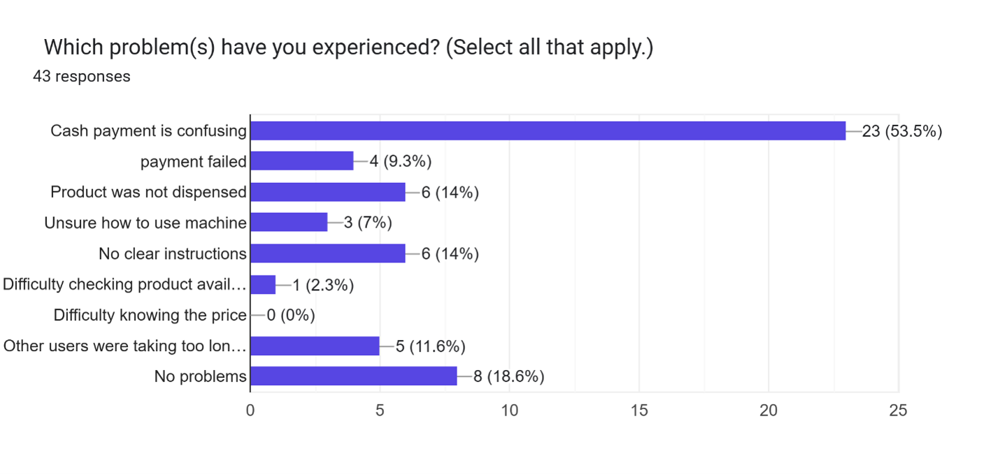
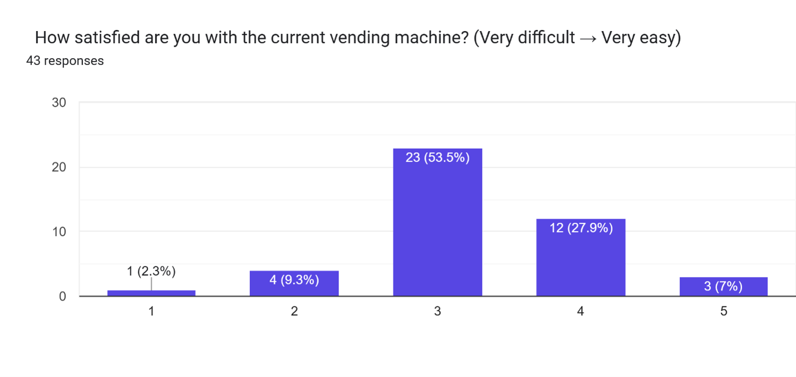
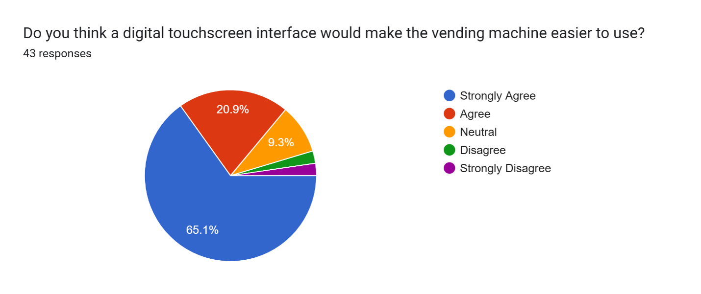
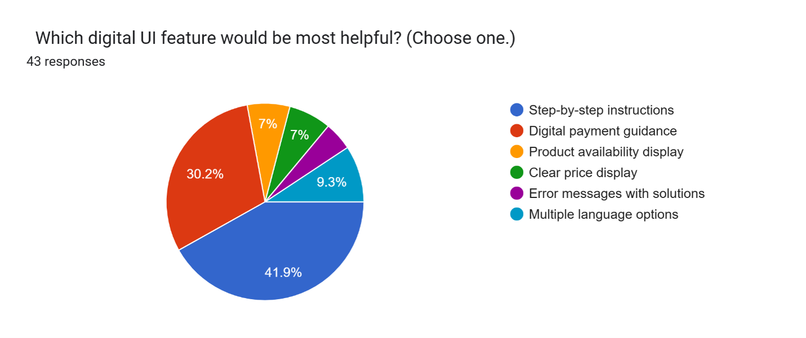
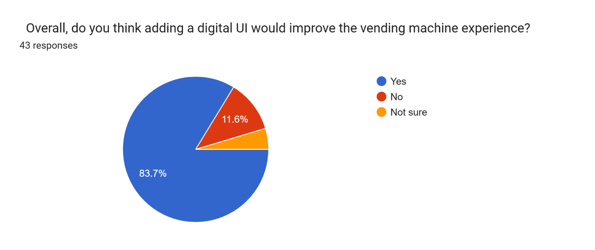

<div align="center">
  
  <br><br>

  # 🥤 ALDOUS RESOURCES — Smart Vending Machine Touchscreen UI/UX Design
  ### *Human-Computer Interaction (HCI) Empirical Kiosk Research, Task Analysis & 8-Screen Figma Prototype*

  <br>

  [-B31B1B?style=for-the-badge&logo=google-scholar&logoColor=white)](#)
  [-003366?style=for-the-badge&logo=academia&logoColor=white)](#)
  <br>
  [](https://www.figma.com/design/sF264iTYbzw2D4oZBFAdCc/HCI-Vending-Machine-UI?node-id=0-1&p=f&t=3bXo7ffHJfffthdV-0)
  [](#)
  [](#)
  [](#)

  <br>

  **Module:** HCI 3202 — Human Computer Interface (Section: 6H1 / 6MB1)  
  **Session:** June 2026 (Student Mobility Program — Fully Funded Scholarship)  
  **Faculty:** Faculty of Data Science and Information Technology, INTI International University, Nilai, Malaysia  
  **Lecturer / Examiner:** Kala Devi Managuran  
  **Live Figma Prototype:** [🔗 View Interactive 8-Screen Kiosk Prototype](https://www.figma.com/design/sF264iTYbzw2D4oZBFAdCc/HCI-Vending-Machine-UI?node-id=0-1&p=f&t=3bXo7ffHJfffthdV-0)

</div>

---

## 📖 Table of Contents
- [📌 Project Overview & Mobility Context](#-project-overview--mobility-context)
- [⚠️ Problem Justification: Manual Vending Machine Deficiencies](#️-problem-justification-manual-vending-machine-deficiencies)
- [🛠️ HCI Methodologies, Heuristics & Tools](#️-hci-methodologies-heuristics--tools)
- [🎯 Target Users & Hierarchical Task Analysis (HTA)](#-target-users--hierarchical-task-analysis-hta)
- [📊 Empirical Data Gathering & Survey Evaluation](#-empirical-data-gathering--survey-evaluation)
- [🧭 Interaction Design & 8-Screen Kiosk Architecture](#-interaction-design--8-screen-kiosk-architecture)
- [📱 Visual Walkthrough: 8-Screen Figma Touchscreen UI](#-visual-walkthrough-8-screen-figma-touchscreen-ui)
- [✅ Heuristic Justification of Prototype Design](#-heuristic-justification-of-prototype-design)
- [📂 Repository File Structure](#-repository-file-structure)
- [👥 Project Team & Academic Details](#-project-team--academic-details)

---

## 📌 Project Overview & Mobility Context
**ALDOUS RESOURCES — Smart Vending Machine Touchscreen UI/UX Design** is a Human-Computer Interaction (HCI) and Self-Service Technology (SST) redesign project completed at **INTI International University (Nilai, Malaysia)** during the **June 2026 Session** as part of a **Fully Funded International Student Mobility Scholarship Program**.

Supervised by **Kala Devi Managuran** in the Faculty of Data Science and Information Technology, this study investigates the usability failures of the physical **ALDOUS RESOURCES** snack and beverage vending machines operating on the INTI Nilai campus. Relying entirely on mechanical push-buttons and manual coin/note slots without an interactive display, the legacy machine creates severe friction in stock verification, price visibility, cash handling, and cashless payment adoption (`Touch 'n Go eWallet` and contactless cards).

To engineer an evidence-based solution, our team conducted a quantitative campus-wide usability survey of **$n = 43$ INTI students and staff**, performed a structured 8-step **Task Analysis**, and designed a modern **8-screen Digital Touchscreen Kiosk UI in Figma** grounded in **Jakob Nielsen's 10 Usability Heuristics**.

---

## ⚠️ Problem Justification: Manual Vending Machine Deficiencies
Self-Service Technologies (SSTs) in high-traffic university environments must deliver rapid, error-free, and autonomous transactions. Our baseline evaluation of the physical ALDOUS RESOURCES vending machine revealed critical usability breakdowns:

* **💸 High Transaction & Payment Friction:** **60.5%** of surveyed campus users reported experiencing operational failures, with **53.5%** citing confusing cash payment mechanics and **67.4%** experiencing payment process confusion at least once.
* **🔇 Lack of System Status Visibility:** Without a digital screen, users cannot verify whether their coin insertion, eWallet scan, or slot selection has been registered—resulting in **14.0%** of users experiencing paid products failing to dispense and **9.3%** encountering silent payment failures.
* **📋 Ambiguous Instructions & Cognitive Load:** Only **39.5%** of respondents agreed that the physical machine's instructions were clear, while **58.1%** remained neutral and **14.0%** cited a complete lack of clear guidance.
* **⏳ Queue Bottlenecks Between Classes:** With **55.8%** of surveyed students using the vending machine **daily** between lectures, interface hesitation caused **11.6%** of users to report long wait times behind confused customers.

---

## 🛠️ HCI Methodologies, Heuristics & Tools

| Category | Methodology / Tool | Application in Project |
| :--- | :--- | :--- |
| **UI/UX Prototyping** | 🎨 **Figma** | High-fidelity 8-screen vertical touchscreen kiosk interface with interactive step progression (`1. BROWSE` ➔ `2. CART` ➔ `3. CHECK` ➔ `4. PAY` ➔ `5. DONE`) |
| **Quantitative UX Research** | 📋 **Google Forms Survey ($n = 43$)** | Closed-ended multiple-choice, multi-select checkbox, and 5-point Likert-scale usability evaluation |
| **Usability Framework** | 📐 **Nielsen's 10 Usability Heuristics** | Applied *Visibility of System Status*, *User Control & Freedom*, *Error Prevention*, and *Help Users Recognize, Diagnose, and Recover from Errors* |
| **Task Modeling** | 🔄 **8-Step Task & Sub-Task Decomposition** | Direct 1-to-1 mapping between user purchasing sub-tasks and the 8 proposed touchscreen UI screens |
| **Payment Localization** | 💳 **Malaysian Cashless Ecosystem** | Native UI flows for **Cash (MYR)**, **Touch 'n Go (TnG) eWallet QR**, and **Contactless Debit/Credit Card (PayWave)** |

---

## 🎯 Target Users & Hierarchical Task Analysis (HTA)

### 👥 Target User Segments
1. **Primary Users — Undergraduate & Exchange Students (INTI Nilai Campus):** Tech-savvy, time-sensitive daily users (**55.8% daily usage**) who rely heavily on Malaysian cashless payment methods (`Touch 'n Go eWallet` and debit cards) between classes.
2. **Secondary Users — University Lecturers & Administrative Staff:** Frequent campus users seeking quick, reliable beverage and snack purchases with clear pricing and receipt options.

### 📋 Primary Task & 8 Sub-Task Decomposition
* **Primary Goal:** Confidently select, review, and purchase snack/beverage items from the ALDOUS RESOURCES vending machine with zero payment ambiguity.

| Sub-Task # | User Action / Sub-Task | Mapped Figma Kiosk Screen | Core UX Objective |
| :---: | :--- | :--- | :--- |
| **Step 1** | Browse available snacks and drinks by category or search | `1. Main Dashboard.jpg` | Real-time visual stock, slot ID (`A1`–`C2`), weight, and `RM` price clarity |
| **Step 2** | Select a product to inspect ingredients, weight, and stock status | `2. Product Detail.jpg` | Detailed item verification (`In Stock` badge), quantity selector, and cross-sell suggestions |
| **Step 3** | Confirm item addition before committing to checkout | `3. Add to Cart Confirmation.jpg` | Immediate visual feedback (`Item added to cart`) with choice to `Go to Cart` or `Continue Shopping` |
| **Step 4** | Review selected items, adjust quantities, or remove items | `4. Cart Page.jpg` | Error prevention and user control over line totals, subtotal, and tax/service fees |
| **Step 5** | Verify final order recap and optional eco-friendly e-receipt | `5. Checkout Page.jpg` | Pre-payment order summary (`RM 12.20`) and digital receipt toggle (`Email` / `Phone`) |
| **Step 6** | Select preferred payment method (`Cash`, `TnG eWallet`, or `Card`) | `6. Payment Selection.jpg` | Guided multi-modal payment instructions with live countdown timer (`01:54`) and QR/Tap prompts |
| **Step 7** | Diagnose and recover from a declined or timed-out payment | `7. Payment Failed.jpg` | Clear error explanation, zero-deduction assurance, `Try Again`, `Choose Another Method`, and support hotline |
| **Step 8** | Receive collection confirmation and pickup instructions | `8. Order Confirmed.jpg` | Animated dispenser tray cue (`COLLECTION READY`), itemized reference receipt, and `Print/Send Receipt` |

---

## 📊 Empirical Data Gathering & Survey Evaluation
A structured usability survey was conducted among **$n = 43$ students at INTI International University** to quantify existing pain points and prioritize features for the touchscreen redesign.

### 1️⃣ Baseline Problems Experienced (`Figure 1`) & Satisfaction Distribution (`Figure 2`)
* **Top Reported Problems:** `Cash payment is confusing` (**53.5% / 23 users**), `Product was not dispensed` (**14.0% / 6 users**), `No clear instructions` (**14.0% / 6 users**), `Other users taking too long` (**11.6% / 5 users**), and `Payment failed` (**9.3% / 4 users**).
* **Baseline Satisfaction (1–5 Scale):** The majority of students (**53.5% / 23 users**) rated the current machine a mediocre **3 out of 5**, proving that the legacy interface is merely tolerated rather than user-friendly.

| Figure 1: Problems Experienced by Students ($n = 43$) | Figure 2: Baseline Satisfaction Ratings (1–5 Scale) |
| :---: | :---: |
|  |  |

### 2️⃣ Demand for Touchscreen UI (`Figure 3`) & Most Helpful Digital Features (`Figure 4`)
* **Touchscreen Demand:** **86.0%** of respondents (**65.1% Strongly Agree** + **20.9% Agree**) confirmed that a digital touchscreen interface would make the vending machine significantly easier to use.
* **Most Requested Digital Features:** `Step-by-step instructions` (**41.9%**) and `Digital payment guidance` (**30.2%**) ranked as the top two priorities, accounting for **72.1%** of all responses.

| Figure 3: Agreement on Digital Touchscreen Usability | Figure 4: Most Helpful Digital UI Feature Priority |
| :---: | :---: |
|  |  |

### 3️⃣ Overall Experience Impact (`Figure 5`)
* **Overall UX Improvement:** **83.7%** of students confirmed that adding a digital UI would improve the overall vending machine experience, and **69.8%** stated they would use the machine **more frequently** once upgraded.

<div align="center">
  
  <p><i>Figure 5: Overall student evaluation on whether a digital UI would improve the vending machine experience (83.7% Yes).</i></p>
</div>

---

## 🧭 Interaction Design & 8-Screen Kiosk Architecture
The ALDOUS RESOURCES kiosk interface is structured around a **Linear Guided Step-Progression Architecture** (`BROWSE` ➔ `CART` ➔ `CHECK` ➔ `PAY` ➔ `DONE`) persistent at the bottom of every screen, ensuring users always know their exact position in the transaction lifecycle.

```text
+-----------------------------------------------------------------------------------+
|               ALDOUS RESOURCES — 8-SCREEN KIOSK NAVIGATION FLOW                   |
+-----------------------------------------------------------------------------------+

  [1. Main Dashboard] ──────> [2. Product Detail] ──────> [3. Add to Cart Confirm]
   • Category Tabs             • "In Stock" Badge          • Item Added Feedback
   • Slot Badges (A1-C2)       • Qty (-/+) Selector        • "Continue Shopping" ──┐
   • Live Cart Footer          • "Goes Great With"         • "Go to Cart"          │
           ^                                                       │               │
           └───────────────────────────────────────────────────────┼───────────────┘
                                                                   v
  [6. Payment Selection] <─── [5. Checkout Page] <─────── [4. Cart Page]
   • Cash (MYR) Tracker        • Order Recap & Edit        • Line Item Qty / Delete
   • TnG eWallet QR (01:54)    • Eco E-Receipt Toggle      • Subtotal & Tax (RM)
   • Debit/Credit PayWave      • Instant Dispense Note     • "Proceed to Checkout"
           │
           ├─────────────────────────┐
           v (On Declined/Timeout)   v (On Verified Payment)
  [7. Payment Failed]         [8. Order Confirmed]
   • Zero-Deduction Notice     • "COLLECTION READY" Tray Visual
   • "Try Again" / Switch      • Transaction Ref (#AL-98234-X)
   • Support (+60 12-345 6789) • Print / Send Receipt & Reset
```

---

## 📱 Visual Walkthrough: 8-Screen Figma Touchscreen UI

### 🛒 Stage 1: Product Discovery, Selection & Cart Confirmation (Screens 1 – 4)

| Screen 1: Main Dashboard (`Browse`) | Screen 2: Product Detail (`Slot A1`) |
| :---: | :---: |
|  |  |
| *Search bar, category pills (`Chips & Snacks`, `Chocolate & Wafers`), slot tags (`A1`–`C2`), clear `RM` pricing, and sticky cart bar.* | *High-res product card (`Bergas BBQ Chips Large - RM 4.50`), `In Stock` badge, quantity adjuster, and `Goes Great With` pairings.* |

| Screen 3: Add to Cart Confirmation | Screen 4: My Cart Review (`Cart`) |
| :---: | :---: |
|  |  |
| *Modal confirmation preventing accidental single-item lock-in, offering `Go to Cart` or `Continue Shopping`.* | *Full item control (`Slot: A-24`, `Slot: C-12`), quantity steppers, delete icons, and transparent `Subtotal` + `Tax` breakdown (`RM 12.20`).* |

---

### 💳 Stage 2: Checkout, Multi-Modal Payment & Error/Success Handling (Screens 5 – 8)

| Screen 5: Checkout & E-Receipt (`Check`) | Screen 6: Payment Method Selection (`Pay`) |
| :---: | :---: |
|  |  |
| *Final order recap with `Edit Items` shortcut and optional environmentally friendly **E-Receipt** (`Email` / `Phone`).* | *Unified payment hub supporting **Cash (MYR)** live counter, **TnG eWallet QR** with `01:54` timer, and **Debit/Credit Card** `READY TO TAP`.* |

| Screen 7: Payment Declined / Error Recovery | Screen 8: Order Confirmed (`Done`) |
| :---: | :---: |
|  |  |
| *Explicit reassurance (`No amount was deducted`), `Try Again`, `Choose Another Payment Method`, and support contact (`+60 12-345 6789`).* | *Illuminated dispenser tray prompt (`COLLECTION READY`), itemized receipt (`#AL-98234-X`), and `Print / Send Receipt`.* |

---

## ✅ Heuristic Justification of Prototype Design

<details>
<summary><b>🔍 Click to Expand: Mapping Survey Pain Points to Nielsen's 10 Usability Heuristics</b></summary>
<br>

| Survey Pain Point Identified | Affected Users | Touchscreen UI Solution Implemented | Nielsen Usability Heuristic Applied |
| :--- | :---: | :--- | :--- |
| **Payment process confusion & cash uncertainty** | `67.4%` (`53.5%` Cash) | Dedicated **Payment Method Selection** screen separating `Cash (MYR)` (with live `Amount Inserted: RM 0.00` counter & `Cancel & Refund`), `TnG eWallet` QR, and `Card` tap. | **#1 Visibility of System Status** & **#2 Match Between System and the Real World** |
| **Lack of step-by-step guidance & unclear instructions** | `41.9%` Priority (`14.0%` Unclear) | Persistent 5-stage progress tracker (`BROWSE` ➔ `CART` ➔ `CHECK` ➔ `PAY` ➔ `DONE`) at the footer of all 8 screens. | **#6 Recognition Rather Than Recall** & **#4 Consistency and Standards** |
| **Accidental selections & inability to modify orders** | `60.5%` General Issues | **Add to Cart Confirmation** modal and **My Cart** page with `+/-` steppers, trash icons, and `Back` navigation arrows on every screen. | **#3 User Control and Freedom** & **#5 Error Prevention** |
| **Silent payment failures (`9.3%`) & un-dispensed items (`14.0%`)** | `23.3%` Combined | **Payment Declined** screen with explicit root-cause text, one-tap retry/switch buttons, helpline number, and **Order Confirmed** dispenser tray graphic. | **#9 Help Users Recognize, Diagnose, and Recover from Errors** |
| **Difficulty checking stock availability & pricing** | `14.0%` Stock / Price | High-contrast product cards with real-time `In Stock` badges, slot labels (`A1`–`C2`), gram weights, and bold `RM` pricing. | **#8 Aesthetic and Minimalist Design** |

</details>

---

## 📂 Repository File Structure

```text
ALDOUS-Vending-Machine-UI-HCI3202/
├── assets/
│   └── inti-university-seeklogo.png                                     # INTI International University Official Logo
├── Figures/                                                             # Empirical Survey Charts (n = 43)
│   ├── Figure1.png                                                      # Problems Experienced by Students
│   ├── Figure2.png                                                      # Baseline Vending Machine Satisfaction (1-5)
│   ├── Figure3.png                                                      # Agreement on Digital Touchscreen Usability
│   ├── Figure4.png                                                      # Most Helpful Digital UI Feature Priority
│   └── Figure5.png                                                      # Overall Experience Improvement Evaluation
├── Vending Machine Figma UI/                                            # 8 High-Fidelity Touchscreen Prototype Screens
│   ├── 1. Main Dashboard.jpg
│   ├── 2. Product Detail.jpg
│   ├── 3. Add to Cart Confirmation.jpg
│   ├── 4. Cart Page.jpg
│   ├── 5. Checkout Page.jpg
│   ├── 6. Payment Selection.jpg
│   ├── 7. Payment Failed.jpg
│   └── 8. Order Confirmed.jpg
├── Vening Machine Project Report.pdf                                    # Complete Academic Group Project Report
├── The ALDOUS RESOURCES Vending Machine UI Design — HCI3202.pptx        # Project Defense Presentation Slides
└── README.md                                                            # Project Documentation
```

---

## 👥 Project Team & Academic Details

| # | Team Member Name | INTI Student ID | Programme & Section |
| :---: | :--- | :---: | :--- |
| 1 | **Shahadat Hossain** *(Project Lead, UI/UX Designer & Analyst)* | `I26041279` | BITI / BCSI (`6H1 / 6MB1`) — *June 2026 Student Mobility Scholar* |
| 2 | **Rowan Cesar Macuacua** | `I25037217` | BITI (`6H1 / 6MB1`) |
| 3 | **Raduan Mia** | `I25035605` | BITI (`6H1 / 6MB1`) |
| 4 | **Morris Kinyua** | `I24028729` | BITI (`6H1 / 6MB1`) |

* **Course / Module:** `HCI 3202 — Human Computer Interface`
* **Lecturer / Examiner:** **Kala Devi Managuran** (`kaladevi.managuran@newinti.edu.my`)
* **Host Institution:** Faculty of Data Science and Information Technology, **INTI International University**, Nilai, Negeri Sembilan, Malaysia

---

<div align="center">
  <i>Completed during the June 2026 Fully Funded International Student Mobility Program at INTI International University, Malaysia.</i>
</div>